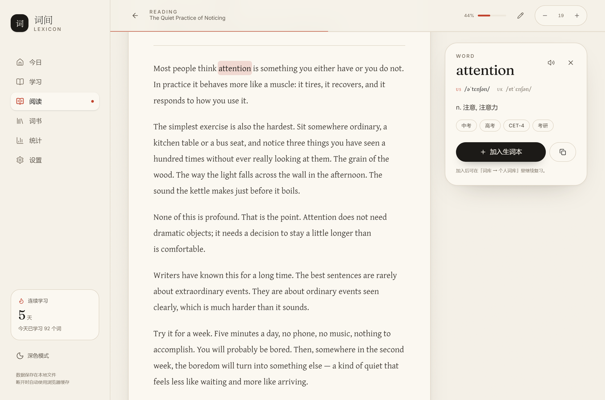
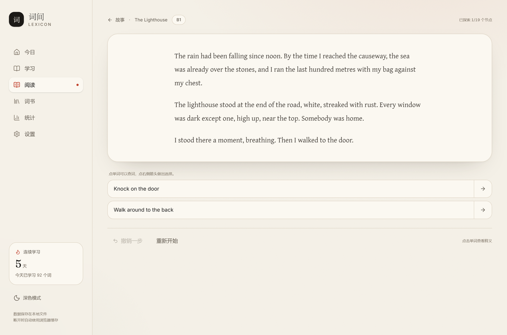
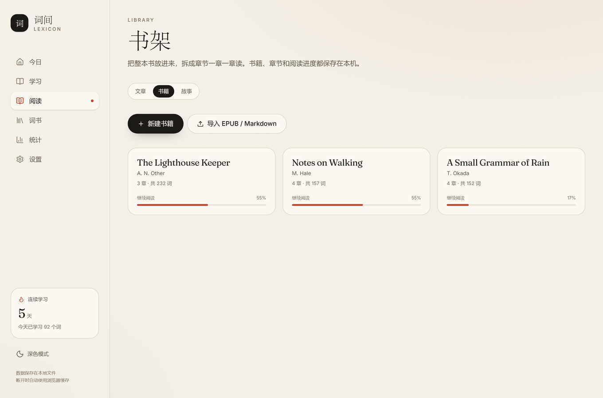
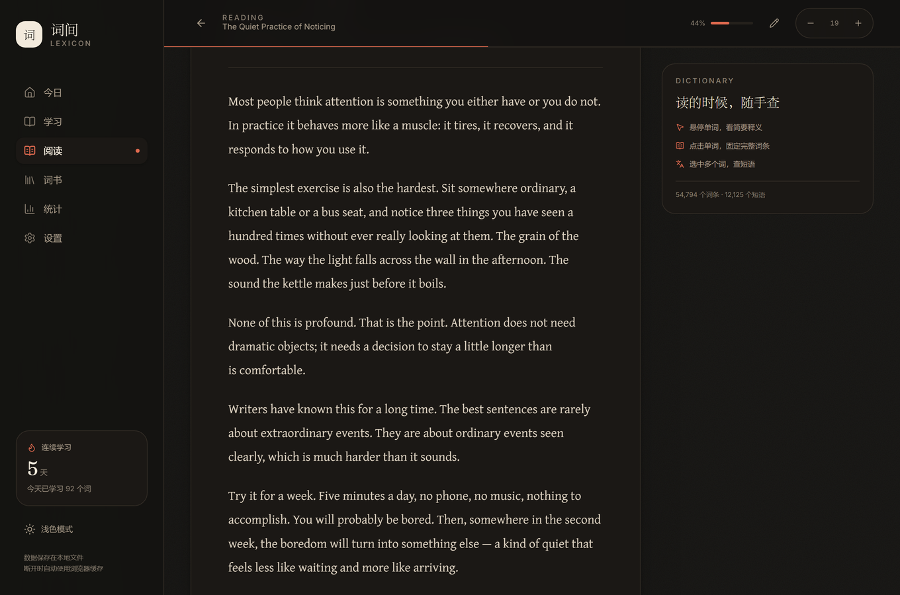

# Lexicon（词间）

一个本地优先的英语学习工具：按 FSRS 间隔重复背单词，把文章和整本书放进来精读，读的时候点一下单词就能查。数据全部保存在本机的 JSON 文件里，不需要账号，也不会上传到云端。

界面基于 React 19 + Vite + TypeScript + Zustand。


## 它能做什么

- **背单词**：FSRS 间隔重复，每日新词/复习上限可调，连续天数与记忆率统计。
- **精读文章**：粘贴或导入文章，悬停看词义、点击固定词条、拖选查短语，生词一键收进个人词库。
- **读整本书**：导入 EPUB / Markdown，自动按目录切章，书架管理，按章阅读并记录进度。
- **互动故事**：带分支和轻状态的短篇——选项会改变变量，世界会记得你，结局收进图鉴。
- **数据自主**：每天自动备份，随时导出/导入完整 JSON，可一键清空。

## 截图

| 今日 | 学习 |
| --- | --- |
|  |  |

| 阅读与查词 | 互动故事 |
| --- | --- |
|  |  |

| 书架 | 统计 |
| --- | --- |
|  |  |

深色模式：



> 截图由 `npm run shots` 生成（会清空数据目录，只对临时目录使用）。

## 环境要求

- Node.js：`^20.19.0 || >=22.12.0`（Vite 8 的要求，可用 `node -v` 检查）
- npm：随 Node.js 一起安装
- Windows 可直接使用 `start.cmd`；其他平台使用下面的 npm 命令

## 启动

### Windows：双击 `start.cmd`

`start.cmd` 会：

1. 查找 Node.js，并检查版本是否满足要求；
2. 在缺少 `node_modules` 时执行 `npm install`；
3. 启动本地开发服务器，并打开 <http://127.0.0.1:5173>。

端口固定为 `5173`，host 固定为 `127.0.0.1`。如果启动失败，窗口会停住并显示原因，不会一闪而过。

### 手动启动

```powershell
npm install
npm run dev -- --host 127.0.0.1 --port 5173 --strictPort
```

然后打开 <http://127.0.0.1:5173>。请通过这个本地服务访问应用，不要直接双击 `dist/index.html`；否则保存数据的本地接口不可用，只能退回到浏览器缓存。

## 数据保存在哪里

默认位置（Windows）：

```text
%APPDATA%\lexicon\
├── study.json            学习设置、卡片进度、每日统计、个人词库
├── reader.json           阅读文章与阅读设置
├── reader-progress.json  文章与章节的阅读进度
├── library.json          书架：书籍与章节正文
├── stories.json          故事：内容、存档与结局图鉴
├── config.json           设置页里可调的本机配置（目前只有导入上限）
└── backups\              自动每日备份
```

其他平台的默认位置：

- macOS：`~/Library/Application Support/lexicon`
- Linux：`${XDG_DATA_HOME:-~/.local/share}/lexicon`

### 自定义数据目录

- 设置环境变量 `LEXICON_DATA_DIR` 可以指定数据目录，建议使用绝对路径。
- 在仓库下创建空文件 `data\.portable`，`start.cmd` 会把数据目录切到仓库内的 `data\`（便携模式）。
- 优先级：`LEXICON_DATA_DIR` > `data\.portable` > 平台默认目录。
- 启动时终端会打印实际使用的数据目录（`Lexicon data: ...`）。

### 导入大小上限

单次导入的请求体上限默认是 **64 MB**，由本地服务校验，客户端会先拿这个值比较所选文件的体积，超限直接提示而不是先把文件读进内存。

- **在「设置 → 数据 → 本地数据」底部可以直接调整**（16 / 32 / 64 / 128 / 256 / 512 MB），改动会先弹确认框，保存到数据目录下的 `config.json`，重启后依然有效。
- 环境变量 `LEXICON_MAX_IMPORT_MB` 只作为**默认值**：没有在设置页保存过时才生效，取值会被收敛到 8–512 MB。
- 不建议调得过大：导入时整份文件要先读进浏览器内存再解析，超出浏览器能承受的范围会直接卡住标签页。

### 备份与恢复

- **手动导出/导入**：在「设置 → 数据」中导出 `lexicon-backup-YYYY-MM-DD.json`，其中包含学习记录、个人词库和阅读库。导入会覆盖当前学习数据；如果备份带有阅读库，也会一并覆盖阅读库。格式错误的条目会被跳过或修正，完全无法识别的文件会被拒绝。导入过程会先校验并在失败时回滚，尽量避免半套数据。
- **自动备份**：服务端在每天第一次写入前，把对应文件复制到 `backups/`，例如 `backups/study-2026-10-24.json`。每种数据保留最近 30 份，三种数据合计最多约 90 份；备份与主文件在同一磁盘，不能替代异地备份。
- **自动备份浏览与恢复（已接入）**：在「设置 → 数据 → 自动备份」可以按 `study` / `reader` / `reader-progress` 分类查看备份列表、大小与时间，点击「恢复」会用所选备份覆盖对应数据。恢复前会自动把当前文件保存为一份安全备份（`*-restore-*.json`），恢复后页面会重新加载。当前版本**不提供**备份删除 UI，如需删除旧备份请到备份目录手动操作。
- **损坏文件隔离（quarantine）**：如果某个数据文件损坏，设置页「本地数据」会标记为「损坏」并提供「隔离损坏文件」。隔离会将文件重命名为 `<kind>.corrupt-<时间戳>-<pid>.json` 保留在数据目录中，不会直接删除。隔离后页面会重新加载，可再从自动备份或手动 JSON 备份恢复。
- **查看占用**：在「设置 → 数据 → 本地数据」可以看到数据目录、备份目录、各数据文件大小、备份总份数与总大小。如果觉得 30 份偏多，可以直接到备份目录手动删除旧文件。
- **清空数据语义**：「清除全部数据」只会删除主数据文件（`study.json`、`reader.json`、`reader-progress.json`），**不会删除** `backups/` 目录。清空弹窗会明确提示备份仍会保留，且需要彻底清理时由用户手动删除备份目录。确认弹窗支持取消（Escape/遮罩/取消按钮）。
- **手动恢复自动备份**：也可以先关闭应用，再把需要恢复的备份文件复制回原文件名，例如把 `backups/study-2026-10-24.json` 覆盖为 `study.json`。备份文件本身是完整的数据信封（包含 `appId`、`revision` 和 `data`），不要只截取其中一部分。

## 书籍模式

「阅读」页面顶部可以在**文章**和**书籍**之间切换，书架在 `/library`。

- **导入**：支持 **EPUB** 和 **Markdown**。EPUB 的章节边界写在文件里（OPF spine + nav/NCX），所以能直接切好；Markdown 按标题层级推断，推断不准时在预览页用「按哪一级标题切」下拉改。
- **导入前先确认**：解析完不会立刻落盘，先进「确认目录」页。可以改书名/作者、改章节名、合并、删除、上下移动；确认后才写入 `library.json`。
- **自己写**：书架可以「新建书籍」，然后一章一章地加、改、删、排序；章节正文有 20 万字符上限，草稿自动保存。
- **读**：章节复用文章阅读器（查词、悬停、短语、进度锚点都在），底部有「上一章 / 目录 / 下一章」。
- **不支持**：TXT（没有章节结构，猜不准）。扫描版或带 DRM 的 EPUB 提取不出文字，导入时会直接报错而不是给你一本空书。

## 互动故事

「阅读」顶部第三个 tab。**是带选择的阅读，不是文字冒险**：没有物品栏、战斗、骰子或自由输入。

- 节点是一段英文正文，底部 2–5 个选项通向别的节点。正文复用阅读器，**点单词照样能查词、加生词本**；选项里的英文也能点词查义，选哪一项要点右侧的箭头。
- **世界记得你**：故事可以有少量变量（`courage`、`helped_stranger`），选项能改变量、也能被变量限制（不满足时置灰并说明，不隐藏），同一节点还能按变量显示不同文本。
- **存档**：每次选择都会保存；「撤销一步」连变量一起回滚；结局会解锁进图鉴（隐藏结局只计入总数，不显示名字）。
- **变量写法**：`effects` 有两种——`{"var":"coins","set":true}` 赋值、`{"var":"coins","add":1}` 累加（负数即扣减）；`requires` 支持 `is` / `gte` / `lte` 和 `all` / `any` / `not` 组合。
- **变量写法**：`effects` 有两种——`{"var":"coins","set":true}` 赋值、`{"var":"coins","add":1}` 累加（负数即扣减）；`requires` 支持 `is` / `gte` / `lte` 和 `all` / `any` / `not` 组合。
- **自己写**：`npm run story:check <file>` 校验、`npm run story:map <file>` 看分支树，或在「故事 → 导出模板」拿一份带全部字段的模板。导入时校验不过会直接拒绝并列出问题。

## 常用脚本

```powershell
npm run dev          # 启动开发服务器（同时提供本地数据接口）
npm run build        # 类型检查并构建到 dist/
npm run preview      # 预览已构建的版本
npm run lint         # oxlint
npm test             # Vitest（校验器与备份解析的纯函数测试）
npm run test:watch   # Vitest 监听模式
npm run dicts        # 重建 public/data/books 词书数据（需要网络）
npm run reader-data  # 重建 public/data/reader 阅读词典数据（需要网络）
npm run icons        # 重新生成 PWA 图标
npm run smoke:reader # 无头 Chrome 跑一遍阅读页（需先启动 dev 服务）
npm run smoke:app    # 首启引导 / 键盘查词 / 时间异常提示（加 --force-clean 会清数据）
npm run smoke:books  # 造一本 EPUB 走完导入、改目录、章节阅读与跳转
npm run smoke:stories # 内置短篇玩到结局、撤销一步、检查图鉴解锁
npm run story:check  # 校验一个故事 JSON（作者用）
npm run story:map    # 打印故事分支树（作者用）
npm run smoke:app    # 首启引导 / 键盘查词 / 时间异常提示（加 --force-clean 会清数据）
npm run smoke:books  # 造一本 EPUB 走完导入、改目录、章节阅读与跳转
npm run smoke:stories # 内置短篇玩到结局、撤销一步、检查图鉴解锁
npm run story:check  # 校验一个故事 JSON（作者用）
npm run story:map    # 打印故事分支树（作者用）
```

`dicts` 和 `reader-data` 会从 ECDICT 与 ipa-dict 拉取源数据（版本已固定到具体 commit，产物可复现），耗时取决于网络；生成结果在 `public/data/`。脚本也支持通过 `LEXICON_RAW_DIR` 环境变量复用本地原始数据缓存（旧名 `LEARNWORD_RAW_DIR` 仍兼容，新名优先）。

## 项目结构

```text
src/
  pages/        每个路由一个页面（今日 / 学习 / 阅读 / 书架 / 故事 / 统计 / 设置）
  components/   按领域分目录：reader、library、story、settings
  hooks/        跨页面复用的状态逻辑（词典、存储、草稿）
  lib/          纯函数：校验、EPUB/Markdown 解析、故事引擎、FSRS、统计、存储适配
  store/        Zustand store，每个数据文件一个（study / reader / library / stories）
  data/         随应用打包的内容（内置短篇）
server/         本地数据接口：读写、原子写、每日备份、事务式导入、损坏隔离
scripts/        词典构建、故事作者工具、无头浏览器冒烟与截图
docs/           审计与修复记录、阶段计划、README 截图
public/data/    词书与阅读词典（构建产物，已提交，保证离线可用）
```

## 故障排查

### 端口 5173 被占用

`start.cmd` 使用了 `--strictPort`，端口被占用时会直接失败并暂停。找到占用进程后关闭它：

```powershell
netstat -ano | findstr :5173
taskkill /PID <PID> /F
```

也可以直接关闭之前残留的终端窗口。不要随意改端口；固定地址与现有文档、浏览器缓存保持一致。

### Node.js 版本不满足

看到 `Unsupported Node.js version` 时，先运行：

```powershell
node -v
npm -v
```

安装 Node.js 20.19+ 或 22.12+ 后重新打开 `start.cmd`。Node.js 21 不在 Vite 8 的支持范围内。

### 数据文件损坏或应用白屏

1. 先不要反复保存，避免覆盖现有数据；备份整个数据目录。
2. 如果只是某个文件损坏，关闭应用后用 `backups/` 中对应日期的备份覆盖它。
3. 如果有之前导出的 JSON 备份，修复顶层结构后可从「设置 → 数据」导入；应用会逐条校验，坏记录会被丢弃并在浏览器控制台给出警告。
4. 页面级渲染错误会显示错误摘要和「重新加载」「返回首页」按钮，可复制摘要用于排查。

### 提示“本地存储服务未连接”

说明页面没有连上 Vite 的本地数据接口。请通过 `start.cmd` 或 `npm run dev` 启动，并确认访问的是 `http://127.0.0.1:5173`，而不是直接打开 HTML 文件。

### 词书或阅读词典加载失败

确认 `public/data/books/`、`public/data/reader/` 存在。如果缺失，运行 `npm run dicts`、`npm run reader-data` 重新生成。

### 启动后数据像是空的

可能是磁盘或浏览器存储较慢，应用在等待 2.5 秒后先以当前内容继续。先刷新页面确认；如果仍然为空，关闭应用并检查数据目录中的 JSON 文件是否完整，或从 `backups/` 恢复。

## 已知限制

- 单机、单用户使用；没有账号、云同步或多设备合并。
- 同一时间只允许一个标签页写入数据，其他标签页会显示接管/重试界面。
- 开发模式不注册 PWA Service Worker；离线缓存主要面向构建后的 PWA 版本。
- 数据以整份 JSON 文件读写；阅读文章很多或很长时，启动和保存会变慢。
- 导入备份已有基本回滚保护，但仍不是严格意义上的跨多文件原子事务，导入后建议刷新页面确认结果。
- 备份删除需手动到备份目录操作（暂未提供 UI 删除）。
- 有 103 条单元测试和 4 个无头浏览器冒烟脚本，但**没有 CI**，需要手动跑。
- 修改后立刻刷新页面，有极小概率丢掉最后一次写入（页面卸载时的落盘可能被导航打断）。

## 许可证

本项目采用 [MIT License](LICENSE)。

更多待修问题与背景见 [docs/ISSUES.md](docs/ISSUES.md)，开发路线见 [docs/ROADMAP.txt](docs/ROADMAP.txt)。
